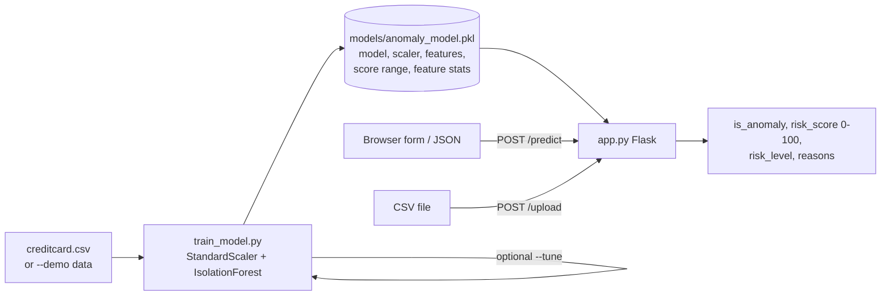

# Fraud Detection Dashboard

Flask app that scores credit card transactions for fraud risk with an IsolationForest, explains each verdict in plain English, and analyzes whole CSV batches.

[](https://github.com/AdityaShekhawat0504/Fraud-detection/actions/workflows/ci.yml)

## Why it matters

Fraud is rare (0.17% of transactions in the Kaggle dataset used here) and labels arrive late, so supervised classifiers have little to learn from. An unsupervised anomaly detector can flag unusual transactions without labels. A bare "fraud / not fraud" flag is hard for an analyst to act on, so this app adds a 0–100 risk score and the features that drove it.

## How it works



- **Model:** scikit-learn `IsolationForest` on `Time`, `Amount` and the PCA features `V1`–`V28`, standardized with `StandardScaler`.
- **Risk score:** `score_samples()` is mapped linearly to 0–100 using the score range seen at training time. Low < 40 ≤ Medium < 70 ≤ High.
- **Explanations:** each feature is compared with its training mean and standard deviation. Features with |z| > 2.5 are listed as reasons, for example *"Amount ($4,832.00) is unusually high (avg: $88.35)"*.
- **Tuning (`--tune`):** two-phase search on an 80/20 stratified split. Phase 1 picks `n_estimators`, `max_samples`, `max_features` by ROC-AUC (18 combinations). Phase 2 picks `contamination` by F1 (8 values).

More detail: [docs/ARCHITECTURE.md](docs/ARCHITECTURE.md).

## Results

Measured by running `python train_model.py --tune` on the full Kaggle Credit Card Fraud dataset (284,807 transactions, 492 frauds). The metrics are printed by the script. The final model is trained on all rows and evaluated on the same rows, so treat these as in-sample numbers.

Best structure from phase 1: `n_estimators=100, max_samples=0.5, max_features=0.8` (test ROC-AUC 0.9613).

Phase 2, contamination sweep on the test split (selection of the 8 values):

| contamination | Precision | Recall | F1 |
|---|---|---|---|
| 0.001 | 0.40 | 0.24 | 0.30 |
| 0.002 | 0.30 | 0.38 | 0.33 |
| **0.003** | **0.27** | **0.47** | **0.34** |
| 0.005 | 0.20 | 0.62 | 0.31 |
| 0.010 | 0.11 | 0.73 | 0.20 |

Final model (`contamination=0.003`) on the full dataset:

| Metric | Value |
|---|---|
| ROC-AUC | 0.9539 |
| Precision | 0.27 |
| Recall | 0.46 |
| F1 | 0.337 |

So the model catches about half of all frauds, and about one in four flagged transactions is actually fraud. The real dataset is not in this repo, and these numbers were not re-run for this README.

The models you get from `--demo` (below) are trained on synthetic data. Their metrics say nothing about real fraud detection.

## Quickstart

Python 3.11 or 3.12.

```bash
git clone https://github.com/AdityaShekhawat0504/Fraud-detection.git
cd Fraud-detection
python -m venv .venv
source .venv/bin/activate          # Windows: .venv\Scripts\activate
pip install -r requirements.txt

python train_model.py --demo       # synthetic data, ~5 seconds
python app.py                      # http://localhost:5000
```

`--demo` writes `models/anomaly_model.pkl` and a 200-row sample at `data/demo_transactions.csv` that you can upload in the batch section.

Try the API:

```bash
curl -X POST http://localhost:5000/predict \
  -H "Content-Type: application/json" \
  -d '{"time": 0, "amount": 4832.0, "v1": -3.1, "v2": 2.4}'
```

`time` and `amount` are required, missing `v1`–`v28` default to 0. The response has `is_anomaly`, `risk_score`, `risk_level` and `reasons`. `GET /health` lists the model's features.

**Train on the real data:** download the [Kaggle Credit Card Fraud dataset](https://www.kaggle.com/datasets/mlg-ulb/creditcardfraud), save it as `data/creditcard.csv`, then run `python train_model.py` (fixed parameters) or `python train_model.py --tune` (search, then train). Full tuning on 284k rows takes several minutes on a laptop.

**Tests and lint:**

```bash
pip install -r requirements-dev.txt
ruff check .
pytest
```

The tests train a small model on synthetic data, so they need no download.

Optional setting: `FRAUD_MODEL_PATH` points the app at a different model file (see `.env.example`).

## Tech stack

Python, Flask, scikit-learn (IsolationForest, StandardScaler), pandas, NumPy, vanilla JS + Chart.js, pytest, ruff, GitHub Actions.

## Project structure

```
Fraud-detection/
├── app.py                 # Flask app: scoring, explanations, /predict and /upload
├── train_model.py         # training, --tune search, --demo synthetic data
├── templates/index.html   # dashboard page
├── static/                # script.js, styles.css
├── tests/                 # pytest suite (helpers, training, routes)
├── docs/ARCHITECTURE.md
├── data/                  # creditcard.csv goes here (not tracked)
└── models/                # anomaly_model.pkl is written here (not tracked)
```

## Limitations and next steps

- **Low precision.** About 73% of flagged transactions are legitimate at the chosen threshold. A supervised model (for example gradient boosting on the labels) would likely do much better; IsolationForest was chosen to work without labels.
- **Tuning uses the test split.** Both phases select on the same held-out set, and the final numbers are in-sample. A separate validation split or cross-validation would give an honest estimate.
- **Explanations are per-feature z-scores**, not model attributions. A transaction can be flagged for a feature combination that no single z-score shows. SHAP-style attributions would be more faithful.
- **V1–V28 are anonymized PCA features**, so reasons like "V14 is outside the normal range" are hard to act on outside this dataset.
- **Model is a pickle** loaded at startup. Only load files you trained yourself.
- **Dev server only.** `app.py` runs Flask's debug server; production would need a WSGI server and input size limits on `/upload`.
