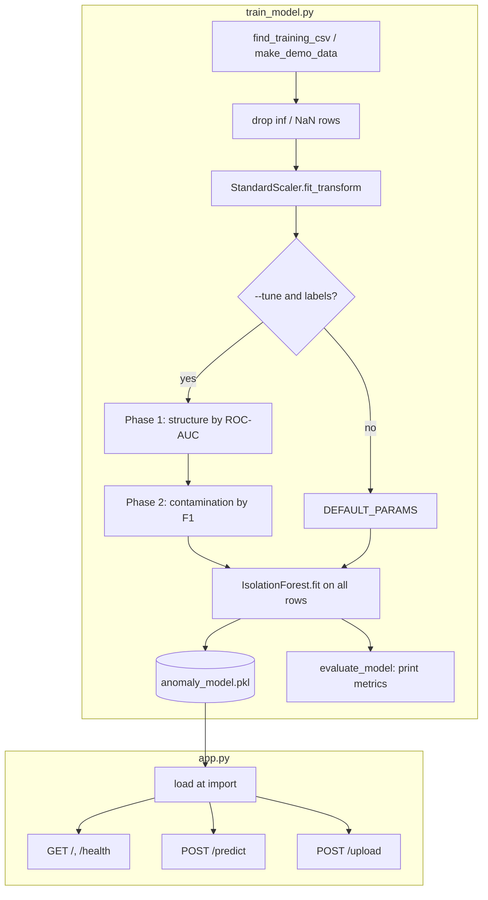

# Architecture

The project has two parts: an offline training script and a Flask app that loads its output. They share nothing at runtime except one pickle file.

## Components

**`train_model.py`**
- `find_training_csv()` looks for `data/creditcard.csv`, then `labeled_transactions.csv`, then `sample_transactions.csv`. Columns are matched case-insensitively; any file with at least 3 of the 30 features works. A `Class`/`label`/`fraud` column, if present, is used for tuning and evaluation only.
- `make_demo_data()` generates synthetic rows with the same columns, used by `--demo` and by the tests.
- `train()` scales, optionally tunes, fits the final model, and writes the bundle.
- `phase1_model_search()` / `phase2_contamination_search()` run the grid search on an 80/20 stratified split.
- `evaluate_model()` prints precision, recall, F1, ROC-AUC, PR-AUC and a confusion matrix.

**Model bundle** (`models/anomaly_model.pkl`): a tuple of
`(model, scaler, features, score_range, feature_stats)`.
- `score_range` is the min and max of `score_samples()` on the training data, used to map new scores to 0–100.
- `feature_stats` holds each feature's training mean and std, used for explanations.

**`app.py`**
- Loads the bundle at import. Path is `models/anomaly_model.pkl` next to `app.py`, or `FRAUD_MODEL_PATH` if set. Fails fast with a clear message if the file is missing.
- `extract_features_from_json()` builds one feature row from lowercase JSON keys; missing V features become 0.
- `normalize_risk_score()` maps a raw score to 0–100 (clipped), `risk_level()` buckets it.
- `explain_transaction()` lists features with |z| > 2.5, with special wording for `Amount` and `Time`, and a fallback reason when none qualify.
- `select_required_columns_case_insensitive()` validates uploaded CSVs.

**Frontend** (`templates/index.html`, `static/script.js`): a form that calls `/predict`, a file input that calls `/upload`, a results table and a Chart.js bar chart of normal vs anomalous rows.

## Data flow for one request

1. `POST /predict` with `{"time": ..., "amount": ..., "v1": ...}`. `time` and `amount` are required.
2. Values are ordered to match the training feature list and scaled with the saved scaler.
3. `model.predict()` gives the anomaly flag (decided by `contamination`). `model.score_samples()` gives the raw score for the 0–100 risk score.
4. Reasons are computed on the unscaled values against the training stats.

`POST /upload` does the same per row after dropping rows with missing or infinite values. Reasons are only computed for flagged rows; the first one is returned as `top_reason`.

## Key design decisions

- **Unsupervised model.** IsolationForest needs no labels to train, which matches how fraud labels arrive in practice. Labels are only used to choose hyperparameters and report metrics.
- **Two-phase tuning.** `contamination` does not change the ranking of scores, so it cannot affect ROC-AUC. The structure is chosen first by a threshold-free metric, then the threshold by F1.
- **Flag and score are separate signals.** `is_anomaly` comes from the model's contamination threshold; `risk_score` is a continuous rescaling. They usually agree but are not tied to each other, so a "Medium" score can still be flagged.
- **Z-score explanations.** Cheap and readable, but they describe how unusual each feature is, not why the forest isolated the point.
- **Everything in one pickle.** Model, scaler, feature order and stats travel together, so the app cannot use a scaler or feature order that does not match the model.
- **Demo mode.** Lets the app and tests run without the Kaggle download. Default and `--tune` training are unchanged.
